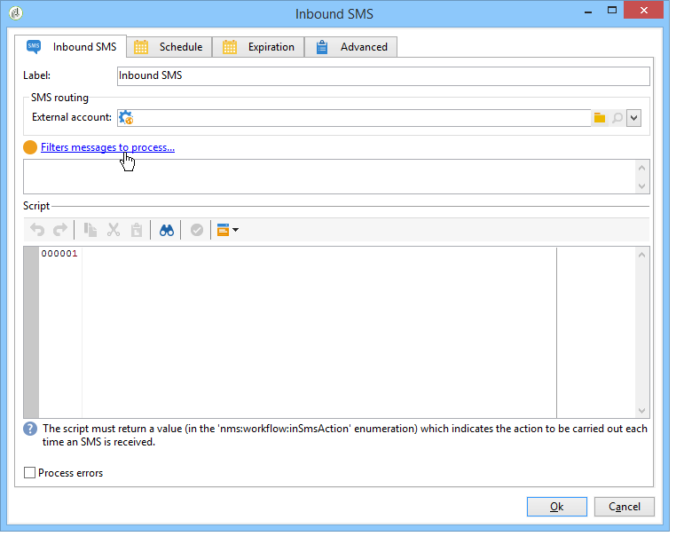
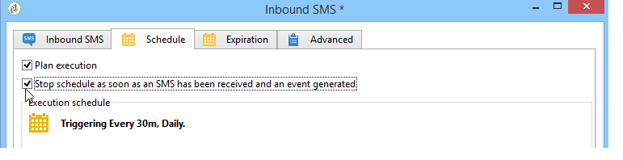

# Réception de SMS{#inbound-sms}

L’activité **Réception de SMS** permet de récupérer et de traiter des SMS depuis un compte externe.

## Propriétés {#properties}

Le premier onglet de l’activité **Réception de SMS** vous permet de renseigner les paramètres de routage des SMS et de saisir le script à exécuter à la réception de chaque message. Le deuxième onglet vous permet d’attribuer un planning à l’activité et le troisième onglet définit les conditions d’expiration de l’activité.

1. **[!UICONTROL Routage SMS]** : sélectionnez le compte externe à utiliser pour la réception des SMS. Les comptes externes sont configurés via le nœud **[!UICONTROL Administration > Plateforme > Comptes externes]** de l&#39;arborescence. [En savoir plus](../../v8/config/external-accounts.md)
1. **[!UICONTROL Script]**
1. **[!UICONTROL Planning]**

   

1. **[!UICONTROL Expiration]**

Les onglets **[!UICONTROL Script]**, **[!UICONTROL Planning]** et **[!UICONTROL Expiration]** sont décrits dans la section [Réception d’emails](inbound-emails.md).
