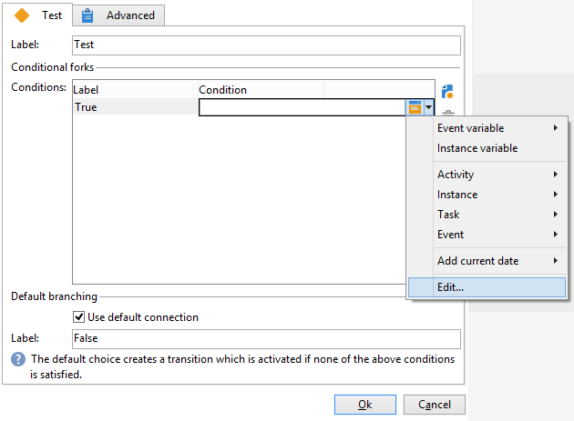

# Test{#test}

Une activité de type **Test** active la première transition qui satisfait la condition qui lui est associée. Si aucune condition n’est satisfaite et que l’option **[!UICONTROL Utiliser le branchement par défaut]** est activée, la transition par défaut sera activée.

Une condition est une expression JavaScript qui doit être déterminée par « true » ou « false ». Pour saisir l’expression, cliquez sur l’icône située à droite du nom de la condition, puis sélectionnez **[!UICONTROL Modifier...]**.

Pour plus d’informations sur toutes les autres fonctions JavaScript et méthodes SOAP du serveur applicatif accessibles via workflow, consultez la [documentation JSAPI](https://experienceleague.adobe.com/fr/tools/campaign-api){target="_blank"}.

Vous pouvez insérer directement des variables également depuis cet éditeur. Pour plus d&#39;informations sur l&#39;utilisation des variables, consultez la section [Variables](javascript-scripts-and-templates.md#variables).

Les conditions peuvent être ajoutées, supprimées, ordonnées depuis la fenêtre d&#39;édition des propriétés de l&#39;activité, mais aussi modifiées depuis la transition.

Si le résultat d’un calcul doit être réutilisé par différentes conditions, il est possible de le calculer dans le script d’initialisation de l’activité. Le résultat doit être stocké dans une variable de la tâche pour être accessible par les scripts de conditions (task.vars.xxx).
