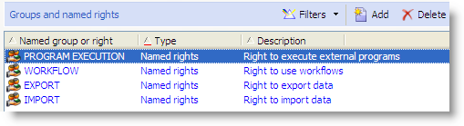

# LinkList

Contrôle de la modification des collections.



## Propriétés

**addButton - boolean** Affiche le bouton d’ajout. Cette option n’est effective que si l’option hideEditButtons est activée.

**backColor - string** Couleur d&#39;arrière-plan (ombre btn, blanc).

**border - string** Modifie le style du contour de contrôle (uni, double, incrustation, départ, aucun).

**dblClickAction - chaîne** Nom du formulaire à ouvrir lors du double-clic.

**delButton - boolean** Affiche le bouton de suppression. Cette option n&#39;est effective que si le bouton hideEditButtons est activé.

**enumImage - string** Nom de l’énumération système utilisée pour afficher l’image de chaque ligne.

**font-size - integer** Modifie la taille de la police.

**form - string** Formulaire pour l&#39;édition de liens.

**hideEditButtons - booléen** : masque les boutons d’ajout, de suppression et de modification.

**img - chaîne** image.

**libellé - chaîne** libellé associé.

**nolabel - booléen** Aucun libellé devant le contrôle.

**noToolbar - boolean** Masque la barre d&#39;outils.

**orderBy - élément** Planification de liste.

**readOnly - boolean** Force le contrôle en lecture seule.

**sysFilter - élément** Filtrage de liste.

**toobarAlign - chaîne** horizontale \| verticale.

**toobarCaption - string** Libellé affiché dans la barre d&#39;outils.

**xpath-link - string** Lien de la liste (voir l’exemple sur les groupes).

**xpathIndex - string** L’index de sélection sera stocké à l’emplacement spécifié par ce chemin d’accès.

**xpathLinkEdit - chaîne** Lien à modifier (voir l’exemple sur les groupes).

**zoom - booléen** Autorise la modification des liens.

## Remarques

Exemples:

```xml
      <input type="linkList" xpath="operator" enumImage="@type" nolabel="true">
  <input xpath="@name" label="Name" colSize="30"/>
  <input xpath="@login"/>
  <sysFilter>
    <condition expr="@type=1"/>
  </sysFilter>
</input>

<input type="linkList" xpath="operator" enumImage="@type" nolabel="true">
  <input xpath="@name" label="Name" colSize="30"/>
  <input xpath="@login"/>
  <form label="Add operators">
  <input xpath="." type="linkListChoice" xpath-link="recipient" img="nms:group.bmp">
  <input xpath="@lastName"/>
  <input xpath="@firstName"/>
  </input>
  </form>
</input>

<input type="linklist" xpath="rcpGrpRel" zoom="true" label="Recipients" form="nms:recipient"
       xpath-link="rcpGroup"
       xpathLinkEdit="recipient">
  <input xpath="recipient/@lastName"/>
  <input xpath="recipient/@firstName"/>
  <input xpath="recipient/@email"/>
  <input xpath="recipient/@phone"/>
</input>
```
