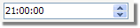

# Heure

Un contrôle de type Heure permet de saisir une heure de la journée.

## Propriétés

**backColor - chaîne** Couleur d&#39;arrière-plan (btnshasow, blanc).

**border - string** Modifie le style de bordure du contrôle (uni, double, inséré, départ, aucun).

**font-size - integer** Modifie la taille de la police.

**libellé - chaîne** libellé associé.

**nolabel - boolean** Masque le libellé associé.

**readOnly - boolean** Force le contrôle en lecture seule.

**obligatoire - booléen** Le champ est obligatoire.
