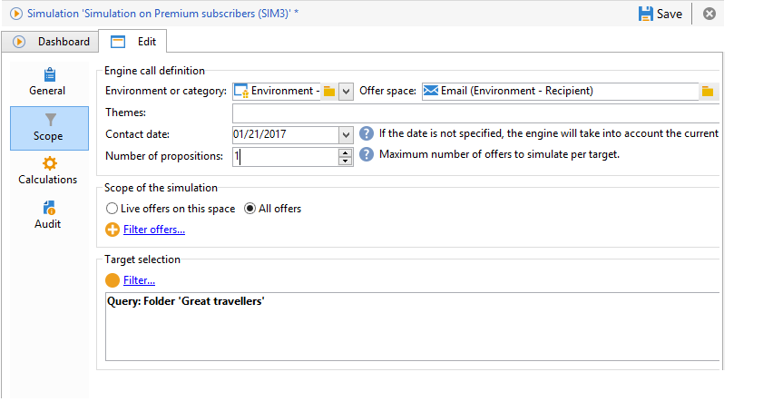
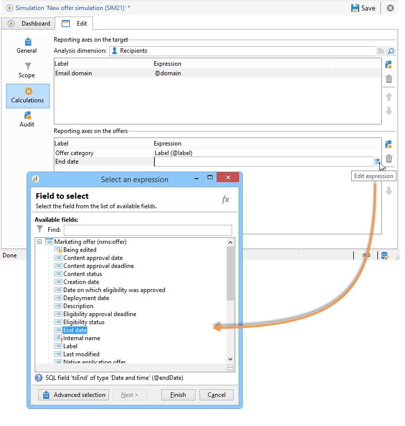

# Périmètre de la simulation{#simulation-scope}

## Définition du périmètre {#definition-of-the-scope}

Positionnez-vous dans l&#39;onglet **[!UICONTROL Périmètre]** pour choisir vos paramètres.

Vous devez définir obligatoirement :

* Un environnement ou une catégorie d&#39;offres.
* Un emplacement.
* Une date de contact. Les offres non éligibles à la date de contact spécifiée ne sont pas prises en compte.
* Une population cible.

  Si vous ne précisez pas de filtre sur votre cible, la totalité de la table des destinataires sera prise en compte dans la simulation.

* Le nombre de propositions à simuler par cible.

  La personne destinataire recevra autant de propositions que le nombre fixé. Par exemple, si le chiffre est 5, chaque personne ciblée recevra au plus 5 propositions d’offre.

  

Pour affiner les offres à prendre en compte pour la simulation, vous pouvez ajouter un ou plusieurs thèmes (définis préalablement au niveau des catégories).

Vous pouvez également choisir d’effectuer la simulation sur toutes les offres ou seulement sur celles en ligne. Certains filtres vous permettent de modifier votre sélection si vous le souhaitez.

>[!NOTE]
>
>Vous devez renseigner une date de contact. Ceci permet au moteur d’interaction d’effectuer un premier tri parmi la totalité des offres contenues dans l’environnement ou la catégorie sélectionné(e). Si aucune date n’est configurée, la simulation génère une erreur.

## Ajout d&#39;axes de reporting {#adding-reporting-axes}

Vous pouvez enrichir l&#39;analyse de la simulation en ajoutant des axes de reporting sur la cible ou les offres elles-mêmes depuis l&#39;onglet **[!UICONTROL Calculs]**.

Pour ce faire, cliquez sur le bouton **[!UICONTROL Ajouter]** et sélectionnez les champs appropriés. Les axes seront utilisés pour le calcul de la simulation et apparaîtront dans le rapport d’analyse. Pour plus d&#39;informations, consultez la section [Suivi des simulations](simulation-tracking.md).

