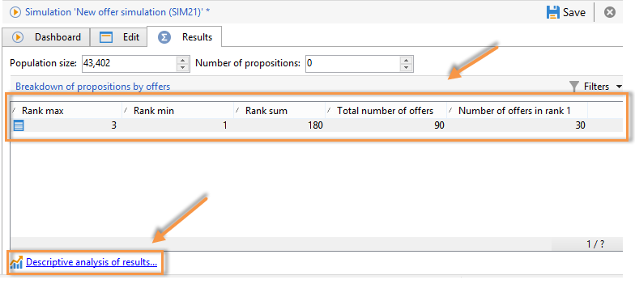
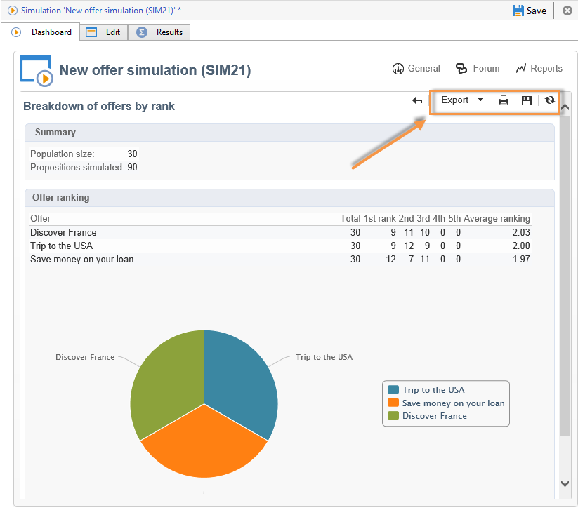

# Suivi des simulations{#simulation-tracking}

Une fois la simulation terminée, vous pouvez analyser son résultat à partir de l&#39;onglet **[!UICONTROL Résultats]** qui est ajouté à la fenêtre de simulation et du rapport **[!UICONTROL Répartition des offres par rang]**, disponible via le tableau de bord de la simulation.

Les résultats de la simulation contiennent une répartition des propositions par rang et par destinataire. Les axes de reporting sont également pris en compte et affichés dans cet onglet.

Vous pouvez conserver ces résultats et les exporter si nécessaire en créant un rapport d’analyse descriptive. Pour cela, cliquez sur le lien disponible dans la fenêtre des résultats.

Reportez-vous à [cette section](https://experienceleague.adobe.com/fr/docs/campaign-classic/using/reporting/analyzing-populations/about-descriptive-analysis){target="_blank"} pour plus d’informations sur l’assistant d’analyse descriptive.

Un tableau croisé dynamique permet de visualiser rapidement la répartition des offres par rang. Comme tout rapport dans Adobe Campaign, il peut être exporté, imprimé, archivé ou affiché dans un navigateur web.

Voir à ce propos [cette section](https://experienceleague.adobe.com/fr/docs/campaign-classic/using/reporting/creating-new-reports/actions-on-reports){target="_blank"}.

