# Créer et envoyer des notifications push{#push-notifications-create}

Les diffusions d’applications mobiles vous permettent d’envoyer des notifications aux appareils iOS et Android.

Avant de commencer à envoyer des notifications push avec Adobe Campaign, vous devez vous assurer que les configurations et les intégrations sont en place sur l’application mobile et pour les balises dans Adobe Experience Platform. [En savoir plus sur la configuration des notifications push](push-settings.md).

>[!CAUTION]
>
>Certaines modifications importantes apportées au service Android FCM (Firebase Cloud Messaging) seront publiées en 2024 et pourront avoir une incidence sur votre mise en œuvre d’Adobe Campaign. Il se peut que la configuration de vos services d’abonnement pour les messages push Android doive être mise à jour pour prendre en charge cette modification. Vous pouvez déjà vérifier et agir.

## Création de votre première notification push {#push-create}

Cette section présente les éléments spécifiques à la diffusion de notifications iOS et Android.

>[!IMPORTANT]
>
>Dans le contexte d’un [Déploiement Enterprise (FFDA)](../architecture/enterprise-deployment.md), l’enregistrement mobile est désormais **asynchrone**. [En savoir plus](../architecture/staging.md)

Pour créer une nouvelle diffusion, accédez à l&#39;onglet **[!UICONTROL Campagnes]**, cliquez sur **[!UICONTROL Diffusions]**, puis sur le bouton **[!UICONTROL Créer]** au-dessus de la liste des diffusions existantes.

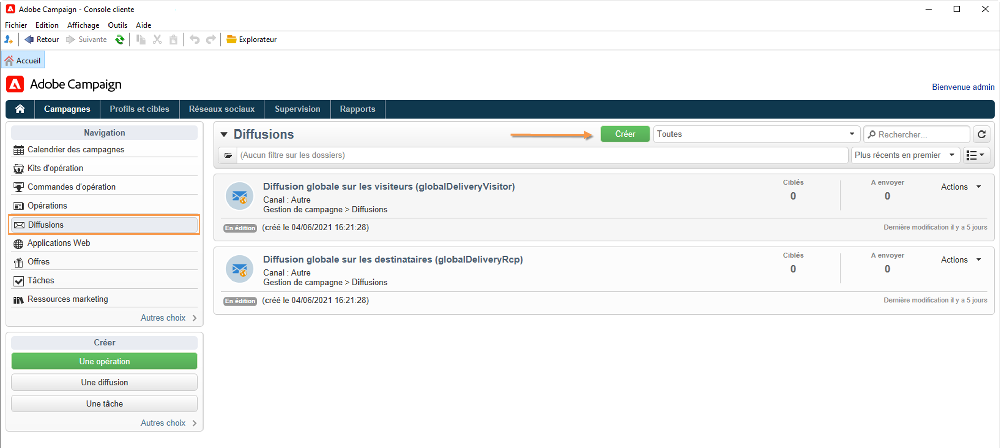

Par défaut, Adobe Campaign est livré avec deux modèles de diffusion : un pour iOS, un autre pour Android. Vous pouvez les dupliquer pour définir vos propres paramètres. Les étapes de configuration d’une diffusion push basée sur ces modèles sont présentées ci-dessous.

>[!BEGINTABS]

>[!TAB iOS]

Pour envoyer des notifications sur les appareils iOS, procédez comme suit :

1. Sélectionnez le modèle de diffusion **[!UICONTROL Diffuser sur iOS]**.

   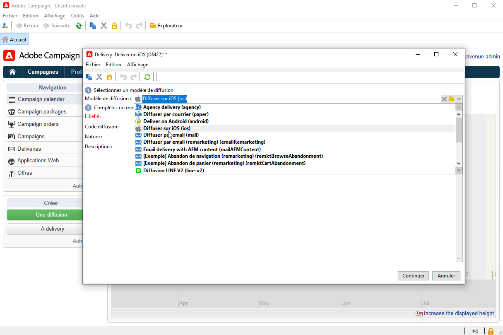

1. Pour définir la cible de la notification, cliquez sur le lien **[!UICONTROL Pour]**, puis sur **[!UICONTROL Ajouter]**.

   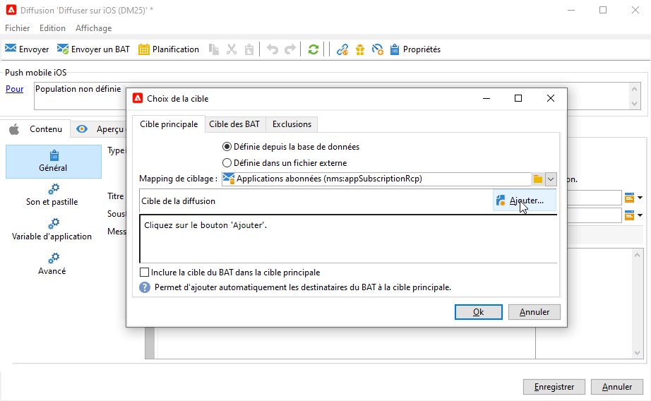

1. Sélectionnez **[!UICONTROL Abonnés d&#39;une application mobile iOS (iPhone, iPad)]**, choisissez le service correspondant à votre application mobile, puis sélectionnez la version iOS de l&#39;application.

   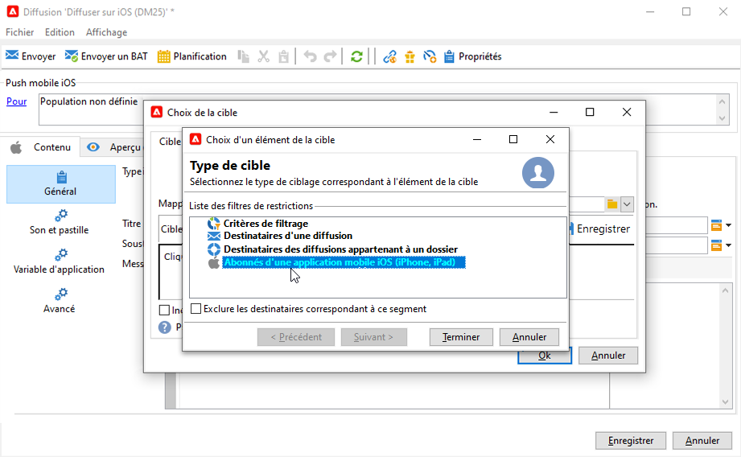

1. Choisissez votre **[!UICONTROL Type de notification]** entre **[!UICONTROL Notification générale (alerte, son, pastille)]** ou **[!UICONTROL Notification silencieuse]**.

   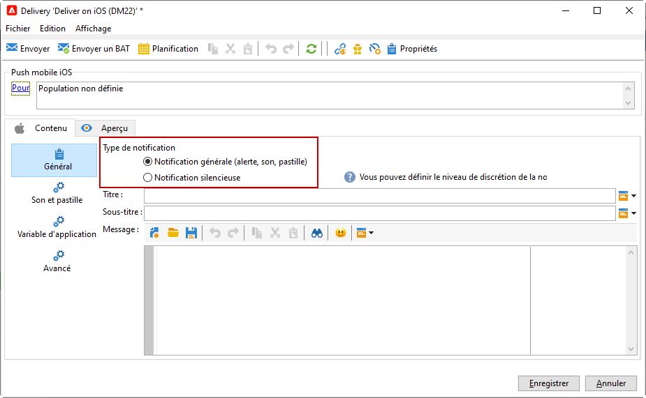

   >[!NOTE]
   >
   >Le mode **Notification silencieuse** permet d&#39;envoyer une notification &quot;silencieuse&quot; à une application mobile. L&#39;utilisateur n&#39;est pas averti de l&#39;arrivée de la notification. Elle est directement transférée à l&#39;application.

1. Dans le champ **[!UICONTROL Titre]**, saisissez le libellé du titre qui doit apparaître dans la liste des notifications disponibles depuis le centre de notifications.

   Ce champ vous permet de définir la valeur du paramètre **Titre** de la payload de notification iOS.

1. Vous pouvez ajouter un **[!UICONTROL Sous-titre]**, valeur du paramètre **sous-titre** de la payload de notification iOS.

1. Saisissez le contenu du message dans la section **[!UICONTROL Contenu du message]** de l’assistant.

1. Dans l’onglet **[!UICONTROL Son et pastille]** vous pouvez modifier les options suivantes :

   * **[!UICONTROL Nettoyer la pastille]** : activez cette option pour actualiser la valeur de la pastille.

   * **[!UICONTROL Valeur]** : définissez un nombre qui sera utilisé pour afficher directement sur l’icône de l’application le nombre de nouvelles informations non lues.

   * **[!UICONTROL Mode d’alerte critique]** : activez cette option pour ajouter du son à votre notification même si le téléphone de l’utilisateur est en mode thème ou si l’iPhone est en mode silencieux.

   * **[!UICONTROL Nom]** : sélectionnez le son que doit émettre le terminal mobile à la réception de la notification.

   * **[!UICONTROL Volume]** : volume de votre son de 0 à 100.

     >[!NOTE]
     > 
     >Les sons doivent être inclus dans l’application et définis lors de la création du service.
     >

   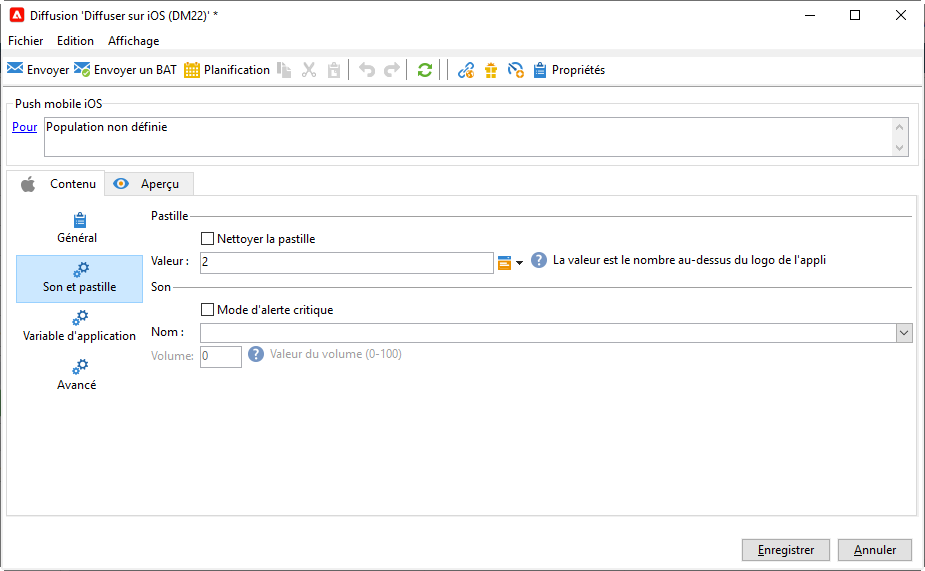

1. Dans l’onglet **[!UICONTROL Variables de l’application]**, vos **[!UICONTROL variables d’application]** sont automatiquement ajoutées. Elles permettent de définir le comportement des notifications. Par exemple, vous pouvez configurer l’affichage d’un écran spécifique lorsque l’utilisateur active la notification.

1. Dans l’onglet **[!UICONTROL Avancé]**, vous pouvez modifier les options générales suivantes :

   * **[!UICONTROL Contenu mutable]** : activez cette option pour permettre à l’application mobile de télécharger le contenu multimédia.

   * **[!UICONTROL Thread-id]** : identifiant utilisé pour regrouper les notifications associées.

   * **[!UICONTROL Catégorie]** : nom de votre identifiant de catégorie qui affichera les boutons d’action. Ces notifications permettent à l&#39;utilisateur d&#39;effectuer plus rapidement différentes tâches en réponse à celles-ci, sans ouvrir l&#39;application ou la parcourir.

   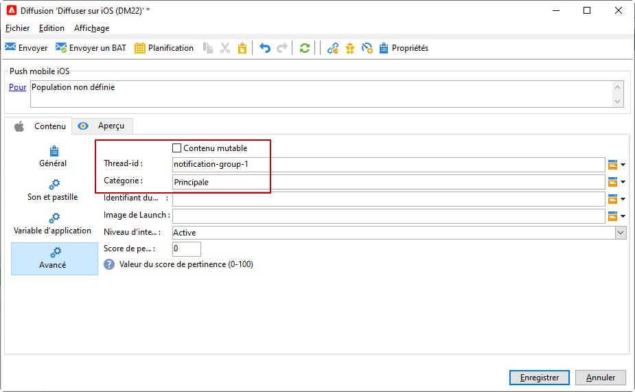

1. Pour une notification sensible à l’heure, vous pouvez spécifier les options suivantes :

   * **[!UICONTROL Identifiant du contenu Target]** : identifiant utilisé pour cibler la fenêtre d&#39;application à afficher au premier plan à l&#39;ouverture de la notification.

   * **[!UICONTROL Image de Launch]** : nom du fichier image de Launch à afficher. Si l’utilisateur choisit de lancer votre application, l’image sélectionnée s’affichera au lieu de l’écran de lancement de votre application.

   * **[!UICONTROL Niveau d&#39;interruption]**:

     * **[!UICONTROL Actif]** : défini par défaut, le système présente immédiatement la notification, illumine l’écran et peut émettre un son. Les notifications ne passent pas en mode Thème.

     * **[!UICONTROL Passif]** : le système ajoute la notification à la liste de notifications sans allumer l’écran ni émettre de son. Les notifications ne passent pas en mode Thème.

     * **[!UICONTROL Sensible à l’heure]** : le système présente immédiatement la notification, allume l’écran, peut émettre un son et passer en mode Thème. Ce niveau ne nécessite pas d’autorisation spéciale de la part d’Apple.

     * **[!UICONTROL Critique]** : le système présente immédiatement la notification, allume l’écran et contourne le bouton de désactivation ou le mode de thème. Notez que ce niveau nécessite une autorisation spéciale de la part d’Apple.

   * **[!UICONTROL Score de pertinence]** : définissez un score de pertinence compris entre 0 et 100. Le système l’utilise pour trier les notifications dans le résumé de la notification.

   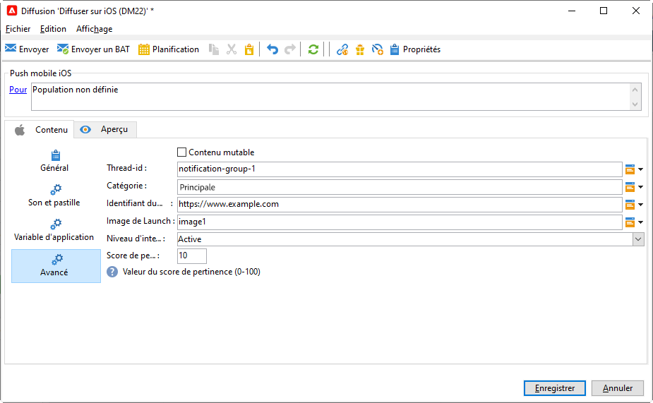

1. Une fois la notification configurée, cliquez sur l&#39;onglet **[!UICONTROL Aperçu]** pour la prévisualiser.

   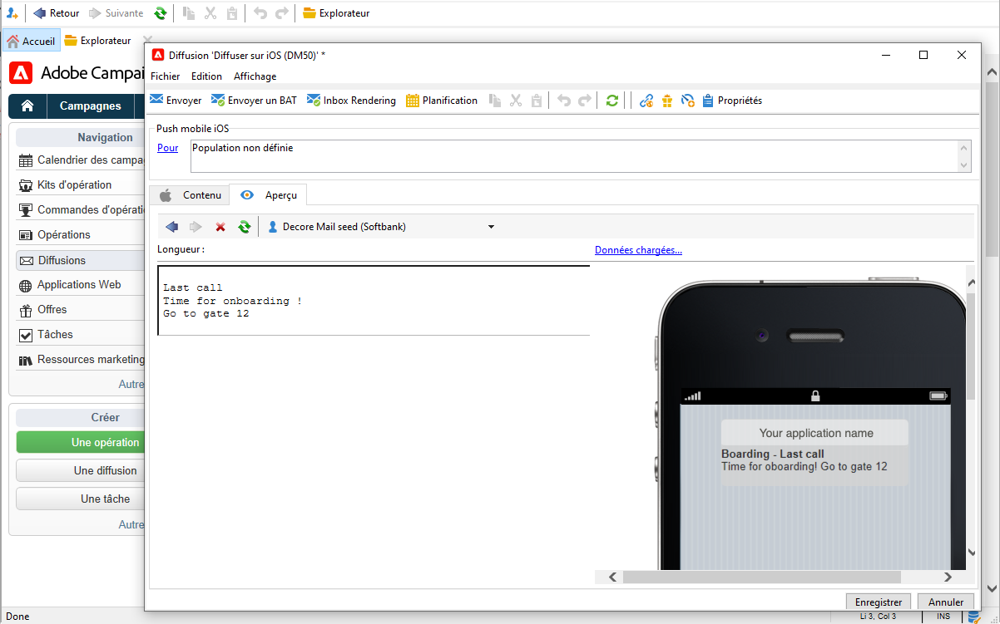

>[!TAB Android]

Pour envoyer des notifications sur les appareils Android, procédez comme suit :

1. Sélectionnez le modèle de diffusion **[!UICONTROL Diffuser sur Android (android)]**.

   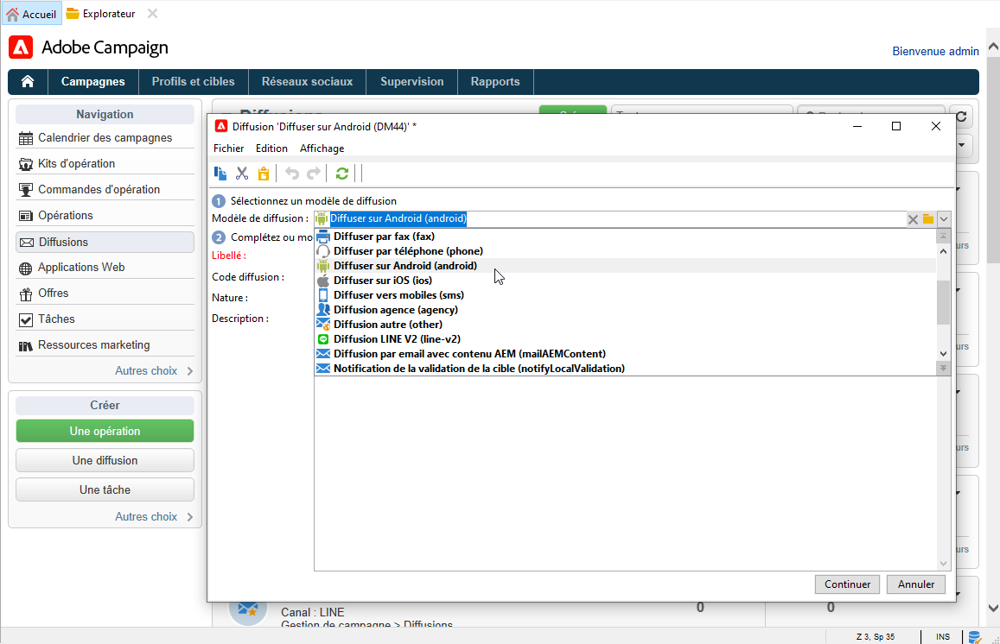

   >[!NOTE]
   > 
   >Avec les dernières API FCM (HTTP v1), vous devez mettre à jour votre **modèles de diffusion** pour les notifications push Android afin d’augmenter le nombre de messages par lot. Pour ce faire, accédez aux propriétés de votre modèle de diffusion Android puis, dans l’onglet **Diffusion**, définissez [Nombre de lots de messages](../../v8/send/configure-and-send.md#delivery-batch-quantity) sur **256**. Appliquez cette modification à tous les modèles de diffusion utilisés pour vos diffusions Android, ainsi qu’à toutes vos diffusions Android existantes.

1. Pour définir la cible de la notification, cliquez sur le lien **[!UICONTROL Pour]**, puis sur **[!UICONTROL Ajouter]**.

   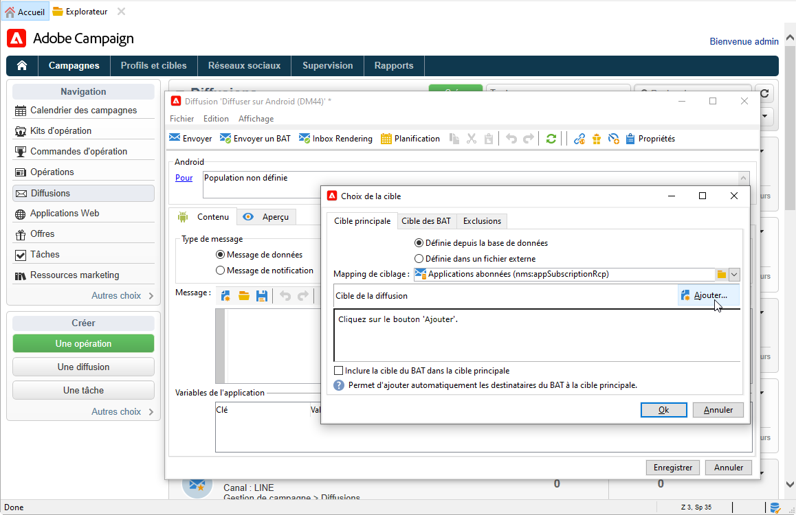

1. Sélectionnez **[!UICONTROL Abonnés d&#39;une application mobile Android]**, choisissez le service correspondant à votre application mobile (Neotrips, dans notre exemple), puis sélectionnez la version Android de l&#39;application.

   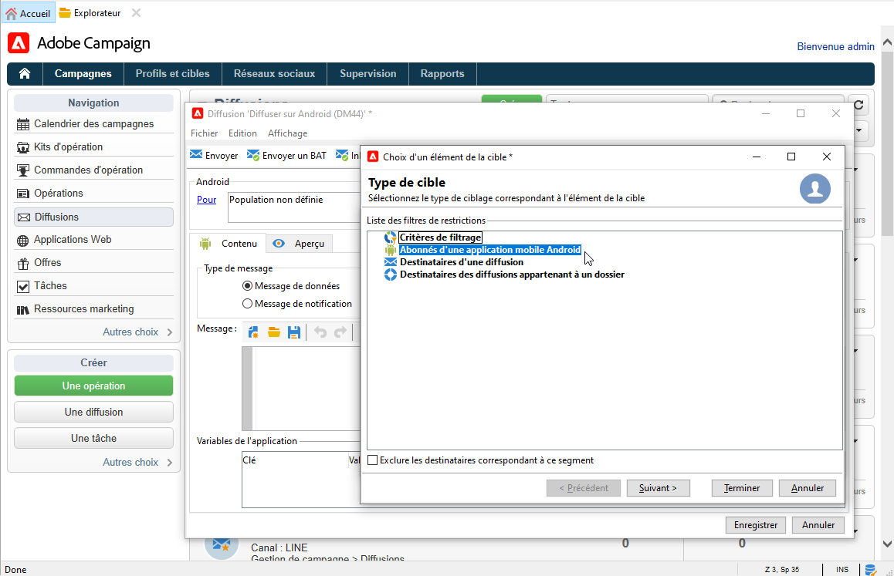

1. Saisissez ensuite le contenu de la notification.

   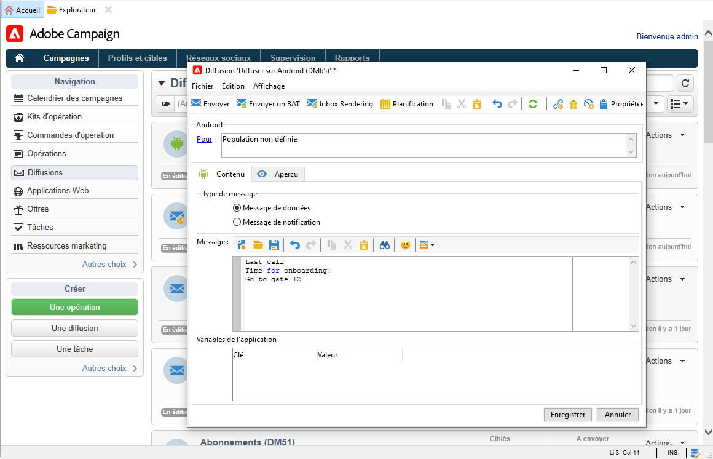

1. Cliquez sur l&#39;icône **[!UICONTROL Insérer une émoticône]** pour insérer des émoticônes dans votre notification push.

1. Dans le champ **[!UICONTROL Variables de l&#39;application]**, saisissez la valeur de chaque variable. Vous pouvez par exemple paramétrer un écran d&#39;application spécifique qui s&#39;affichera lorsque l&#39;utilisateur activera la notification.

1. Une fois la notification configurée, cliquez sur l&#39;onglet **[!UICONTROL Aperçu]** pour la prévisualiser.

   <!---->

>[!ENDTABS]

## Test, envoi et surveillance de vos notifications push {#push-test}

L’envoi du BAT et l’envoi final de la diffusion s’effectuent de la même manière que pour les autres diffusions.

Découvrez comment valider une diffusion dans [Prévisualiser et tester votre e-mail](preview-and-proof.md).

Découvrez comment confirmer et envoyer la diffusion dans [Envoyer et surveiller vos e-mails](send.md)

Après l&#39;envoi des messages, vous pouvez surveiller et suivre vos diffusions. Découvrez les raisons de l’échec de la diffusion des notifications push dans [Types d’erreur des notifications push](delivery-failures.md#push-error-types).

