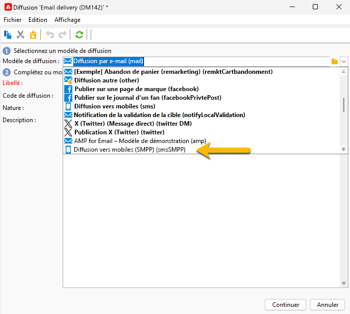
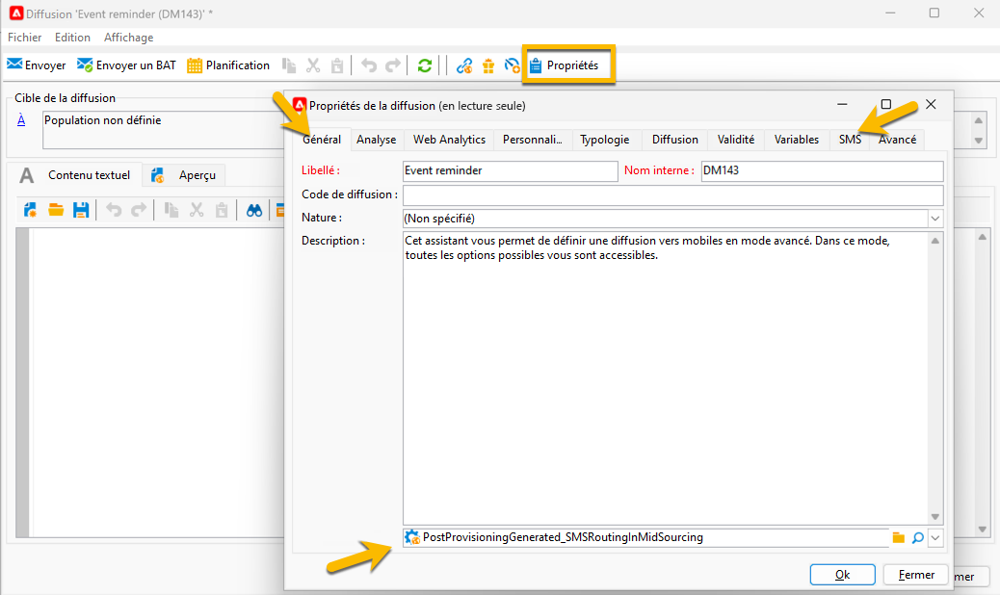

# Créer votre première diffusion SMS {#sms-delivery}

Pour créer une diffusion SMS, procédez comme suit :

1. Créez une diffusion et sélectionnez le [modèle de diffusion SMS](sms-mid-sourcing.md#sms-delivery-template) que vous avez créé pour vos envois de SMS.

   {zoomable="yes"}

   Les étapes de création d&#39;une diffusion sont décrites dans la section [Création de votre première diffusion](../../start/create-message.md).

<!--
 * For standalone instance,  [learn more here](sms-standalone-instance.md#sms-delivery-template).
* For mid-sourcing infrastructure,
-->

1. Renommez votre diffusion dans le champ **[!UICONTROL Libellé]** et ajoutez des informations dans le champ **[!UICONTROL Code de diffusion]** et dans la liste **[!UICONTROL Nature]** si nécessaire pour le suivi. Vous pouvez également ajouter une **[!UICONTROL description]** à votre diffusion.

1. Cliquez sur le bouton **[!UICONTROL Continuer]**. Désormais, vous disposez de tous les paramètres de votre modèle dans votre diffusion.

1. Vous pouvez archiver le bouton **[!UICONTROL Propriétés]** qui est configuré selon vos besoins. [En savoir plus sur l’onglet SMS](sms-delivery-settings.md#sms-tab)

   {zoomable="yes"}

1. [Définissez le contenu](sms-content.md) de votre diffusion.

1. [Sélectionnner l’audience](sms-audience.md).

Les étapes de définition d&#39;une audience sont détaillées sur la page [Créer des audiences de profil dans Campaign](../../audiences/create-audiences.md).

## Valider et envoyer les SMS {#sms-validate}

Après la création de votre diffusion, vous pouvez effectuer les opérations suivantes :

1. [Envoyez des BAT](sms-proofs.md) pour valider le rendu et le contenu.

1. Ensuite, [envoyez à l’audience finale](sms-send.md).

## Surveiller et suivre les SMS {#sms-monitor}

Après l’envoi, [apprenez à surveiller et suivre vos SMS](sms-monitor.md).
